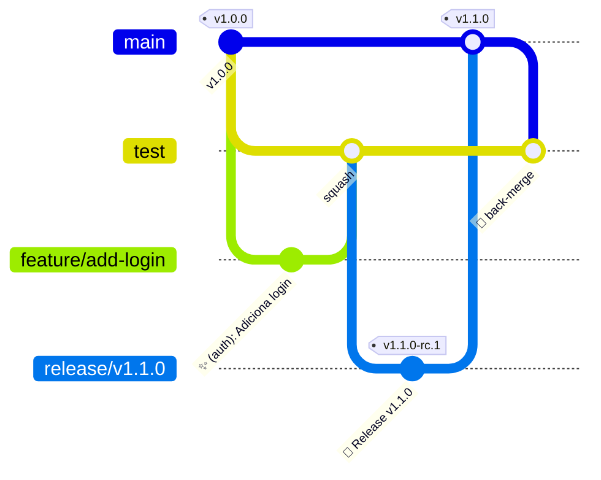

# 🤝 Padrões do repositório

| | Padrão | Onde é garantido |
|---|---|---|
| 🔖 | Versões em [SemVer 2.0.0](https://semver.org) | `release-check` · ruleset de tags |
| 🌳 | Branches em [Conventional Branch](https://conventionalbranch.org) — **sem prefixos de IA** | hook `pre-push` · `conventions` · ruleset (Enterprise) |
| 😜 | Commits em [gitmoji](https://gitmoji.dev/specification) — **sem atribuição de IA** | hook `commit-msg` · `conventions` · ruleset (Enterprise) |
| 📝 | CHANGELOG em [Common Changelog](https://common-changelog.org) | `release-check` |
| 📖 | README atualizado em toda release | `release-check` |
| ✅ | Formatação, lint, tipos e cobertura ≥ 75% (≥ 85% em produção); contêineres (hadolint + trivy) | `ci-ok` |
| 🔐 | Sem segredos nem números de cartão (PAN) no Git — **bloqueia sempre**, mesmo em pré-produção | hook `pre-commit` · `ci-ok` (job 🔐 Segurança) |
| 🗂️ | Templates de issue e PR | issue forms · `pr-template` |
| 💻 | Código 100% em inglês (variáveis, funções, tabelas, colunas) | `standards` |
| 🌐 | Comentários e docs no idioma do projeto (ou multilíngue) | `standards` · `release-check` |
| 🤖 | Arquivos para IA (AGENTS.md, skills, regras) em inglês | `standards` |
| ☁️ | AWS ou Azure com IaC (Terraform/CDK); VPS só para baixa criticidade | `standards` · `infra` · revisão mensal |
| 🗃️ | Banco via ORM | `standards` |

> Tudo que é configurável fica em **`.github/standards.json`**.

> Os validadores ficam em `.github/scripts` (Node ≥ 20, zero dependências) e são os mesmos no hook local, no CI e nas regex dos rulesets. Testes: `node --test .github/scripts/test/*.test.cjs`.

---

## 🌳 Branches

### Trunks

| Branch | Papel | Obrigatória |
|---|---|---|
| `main` | Produção — cada versão é uma tag `vX.Y.Z` aqui | ✅ |
| `test` | Sandbox que consome e mexe no ambiente de produção | opcional |
| `sandbox` | Sandbox isolado | opcional |

### Branches de trabalho — `<tipo>/<descricao>`

| Tipo | Uso | Exemplo |
|---|---|---|
| `feature/` · `feat/` | Funcionalidade nova | `feature/add-login-page` |
| `bugfix/` · `fix/` | Correção de bug | `fix/header-bug` |
| `hotfix/` | Correção urgente em produção | `hotfix/security-patch` |
| `release/` | Preparação de versão | `release/v1.2.0` |
| `chore/` | Dependências, docs, CI, configuração | `chore/update-dependencies` |

Regras: minúsculas, números, hífens e pontos; sem `--`, `..` ou separador nas pontas; release sempre `release/vX.Y.Z`. Pode incluir o ticket: `feat/fig-123-split-payment`.

🙅 **Prefixos de ferramentas de IA da especificação (`ai/`, `claude/`, `codex/`, `copilot/`, `cursor/`) não são usados.** A branch diz *o que* muda, não *quem* escreveu. Configure seus agentes para criar branches com os tipos acima.

Exceções aceitas: `dependabot/…` e `gh-readonly-queue/…` (merge queue).

### Fluxos



| Situação | Caminho |
|---|---|
| **Fluxo completo** (com `test`) | `feature/fix/chore` → PR em `test` → `release/vX.Y.Z` criada a partir de `test` → PR em `main` |
| **Fluxo enxuto** (sem `test`) | `feature/fix/chore` → PR em `main` (acumula) → `release/vX.Y.Z` criada a partir de `main` → PR em `main` |
| **Hotfix** | `hotfix/…` a partir de `main` → PR em `main` (bump PATCH) → back-merge automático para `test`/`sandbox` |
| **Sandbox** | aceita PR de qualquer branch válida — para experimentos |

O check `conventions` detecta sozinho se `test` existe: com ela ativa, `main` só aceita `release/*` e `hotfix/*`.
Depois de cada release, o workflow abre o PR **🔀 Merge main into test** — faça merge com **merge commit**, não squash.

---

## 😜 Commits — [gitmoji](https://gitmoji.dev/specification)

```
<gitmoji> [(escopo)][:] <Mensagem com verbo no imperativo>

[corpo opcional, separado por uma linha em branco]
```

```
✨ Adiciona página de login
🐛 (header): Corrige sobreposição no mobile
♻️ (auth): Extrai serviço de token
💥 Remove suporte ao Node 18
:memo: Documenta setup local
```

- Emoji Unicode ou `:código:` da [lista oficial](https://gitmoji.dev) (cópia fixa em `.github/gitmoji/gitmojis.json`).
- Cabeçalho com até 100 caracteres. Comece com um verbo (vira item do CHANGELOG quase sem reescrever).
- O gitmoji define o impacto na versão — é ele que o `release-check` usa para exigir o bump certo:

| Bump | Gitmojis (campo `semver` da lista oficial) |
|---|---|
| **MAJOR** | 💥 |
| **MINOR** | ✨ |
| **PATCH** | ⚡️ 🐛 🚑️ 💄 🔒️ ⬇️ ⬆️ 📌 📈 ➕ ➖ 🔧 🌐 ✏️ ⏪️ 📦️ 👽️ 🍱 ♿️ 💬 🗃️ 🚸 📱 🥚 ⚗️ 🔍️ 🏷️ 🚩 🥅 💫 🗑️ 🛂 🩹 👔 |
| nenhum | 🎨 🔥 📝 🚀 🎉 ✅ 🔐 🔖 🚨 🚧 💚 👷 ♻️ 🔨 🔀 🚚 📄 💡 🔊 🔇 👥 🏗️ 🙈 📸 🌱 🧐 ⚰️ 🧪 🩺 🧱 🧑‍💻 🧵 🦺 ✈️ … |

> Removeu algo da API pública (🔥 ⚰️ ➖)? Isso é breaking: use 💥 — o gitmoji de remoção sozinho não força major.

### 🙅 Sem atribuição de IA

Commits **nunca** dizem que foram feitos com ou por IA: nada de `Co-Authored-By: Claude/Copilot…`, `🤖 Generated with…`, "feito com IA" e afins. O autor do commit é a pessoa responsável pela mudança.

- O hook `commit-msg` **remove sozinho** os trailers que as ferramentas inserem e rejeita o resto.
- O `conventions` reprova commits com essas menções ou com autor de ferramenta de IA.
- Falar de IA como *assunto* do código é normal: `✨ (ia): Adiciona modelo de recomendação` passa.
- A declaração de uso de IA, quando houver, fica **só no PR** (seção 🤖 do template). O squash usa o título do PR e as mensagens dos commits — a descrição do PR não entra no histórico.

---

## 🔀 Pull Requests

- **Título = mensagem do commit do squash**, no formato gitmoji. PR de release: `🔖 Release vX.Y.Z`.
- O template é aplicado automaticamente pelo prefixo da branch (ver [docs/TEMPLATES.md](docs/TEMPLATES.md)); seções ⭐ são obrigatórias.
- Merge: **squash** em trabalho → trunk; **merge commit** só para back-merge entre trunks.

| Check | Valida | Exigido em |
|---|---|---|
| `ci-ok` | 🎨 formatação · 🚨 lint · 🧪 testes · 📊 cobertura | `main`, `test`, `sandbox` |
| `conventions` | 🌳 branch · 🎯 destino · 🔀 título · 😜 commits · 🙅 IA | todos |
| `release-check` | 🔖 SemVer e bump · 📝 CHANGELOG · 📖 README | `main` |
| `pr-template` | ⭐ seções obrigatórias do template | `main` |
| `standards` | 💻 código em inglês · 🤖 arquivos de IA em inglês · ☁️ políticas de infra, banco e idiomas | todos |

---

## ✅ Qualidade e cobertura

O CI detecta os projetos (`package.json`, `pyproject.toml`, `pubspec.yaml`, até 3 níveis; ou `.github/ci-projects.json`) e roda por stack:

| Stack | 🎨 Formatação | 🚨 Lint | 🧪 Testes → `coverage/lcov.info` |
|---|---|---|---|
| Node · pnpm | `pnpm run format:check` | `pnpm run lint` | `pnpm run test:coverage` |
| Python · uv | `ruff format --check` | `ruff check` | `pytest --cov --cov-report=lcov:…` |
| Flutter | `dart format --set-exit-if-changed` | `flutter analyze` | `flutter test --coverage` |

| Destino | Cobertura mínima de linhas | Variável |
|---|---|---|
| `test`, `sandbox`, demais | **75%** | `COVERAGE_MIN` |
| `main` (produção) | **85%** | `COVERAGE_MIN_PROD` |

Enquanto `IN_PRODUCTION` for `false`, o `ci-ok` só avisa — **exceto o job 🔐 Segurança** (gitleaks + `scripts/quality/scan_pan.py`), que reprova sempre, inclusive em rascunho. Auditoria de dependências (`pnpm audit`, `pip-audit`) é só aviso. **Ao entrar em produção**, defina `IN_PRODUCTION=true` (no Enterprise, pela propriedade `in_production`) e tudo passa a bloquear.

---

## 💻 Idiomas

| O quê | Idioma | Exemplo |
|---|---|---|
| **Código**: variáveis, funções, classes, arquivos, tabelas, colunas, nomes mapeados no ORM | **Inglês, sempre** | `calculateFee(grossAmount)` · tabela `payments` |
| **Texto para pessoas**: comentários, docs, README, commits, PRs, issues, CHANGELOG | Idioma materno do projeto ou multilíngue | `// calcula a taxa MDR do lojista` |
| **Texto para IA**: AGENTS.md, CLAUDE.md, `.claude/**`, SKILL.md, prompts, regras de agentes | **Inglês** (gasta menos tokens) | `Code 100% English.` |

```json
// .github/standards.json
"docs": { "languages": ["pt-BR"] }          // só português
"docs": { "languages": ["en", "pt-BR"] }    // multilíngue: README.md em inglês + README.pt-BR.md
```

- No modo multilíngue, cada idioma extra tem seu `README.<idioma>.md`, e **todos** precisam ser atualizados e citar a versão em cada release.
- Termos de domínio sem tradução (Pix, boleto, CNPJ, CPF, NSU…) ficam liberados em `code.domainTerms` — inclua os do seu projeto.
- O check `standards` olha **só as linhas adicionadas** no PR: código legado em português não trava ninguém, mas não cresce. Para auditar o repositório inteiro: `node .github/scripts/standards.cjs --all`.
- A detecção é heurística: acentos e um dicionário de termos comuns de sistemas brasileiros. Comentários e strings são ignorados; nomes de tabela/coluna em `@map`, `db_column`, `__tablename__`, `Column("…")`, Drizzle e TypeORM são verificados.

---

## ☁️ Infra e DevOps

| Criticidade (`infra.criticality`) | Exemplos | Hospedagem permitida |
|---|---|---|
| `high` | pagamentos, escopo PCI DSS, dados pessoais | **AWS ou Azure**, serviços gerenciados |
| `medium` | APIs internas, backoffice, integrações | **AWS ou Azure** |
| `low` | landing pages, ferramentas internas pequenas, POCs | AWS, Azure ou **VPS com revisão de segurança mensal** |

- **CI/CD**: GitHub Actions. Deploy autentica na nuvem por **OIDC** (credencial temporária) — nunca chave de acesso fixa em segredo.
- **IaC**: tudo em `infra/`, com **Terraform** (AWS e Azure) ou **AWS CDK** (projetos só AWS). Nada criado à mão no console. Estado remoto com lock.
- **Outra nuvem/plataforma** (GCP, Vercel…) só com ADR apontado em `infra.exceptionAdr`.
- **VPS**: proibida para `medium`/`high` e para escopo PCI. O workflow `vps-security-review` abre todo dia 1 uma issue com o checklist da revisão mensal.
- O workflow `infra` valida formatação, sintaxe e segurança (Checkov) a cada mudança em `infra/`, e mostra o plano quando há credenciais OIDC configuradas.

Detalhes em [docs/INFRA.md](docs/INFRA.md).

## 🗃️ Banco de dados

Priorize **ORM**: troca de banco, de nuvem e de ambiente fica barata, e as migrações ficam versionadas no repositório.

| Stack | ORM recomendado | Migrações |
|---|---|---|
| Node / Next.js | Prisma ou Drizzle | `prisma migrate` · `drizzle-kit` |
| Python / FastAPI | SQLAlchemy 2 | Alembic |
| Python / Django | Django ORM | `manage.py makemigrations` |
| Flutter (local) | drift | migrações do drift |

- Declare em `database.engine` e `database.orm`. Banco sem ORM só com ADR em `database.rawSqlAdr`.
- SQL cru só em casos medidos (relatório pesado, bulk) e sempre parametrizado.

---

## 🤖 Agentes de IA

- **`AGENTS.md`** (inglês, enxuto) é a regra única para qualquer agente; `CLAUDE.md` só importa ele.
- **`.claude/settings.json`** já traz:
  - atribuição desligada (`attribution.commit` e `.pr` vazios, `sessionUrl: false`), coerente com a regra de commits sem menção a IA;
  - skills padrão do time, instaladas ao confiar na pasta do projeto:

| Skill | Para quê | Fonte |
|---|---|---|
| 🪨 caveman | respostas curtas, menos tokens de saída | [JuliusBrussee/caveman](https://github.com/JuliusBrussee/caveman) |
| 🐴 ponytail | código mínimo: reaproveitar antes de escrever | [DietrichGebert/ponytail](https://github.com/DietrichGebert/ponytail) |
| 🦸 superpowers | método: brainstorm → plano → TDD → revisão | [obra/superpowers](https://github.com/obra/superpowers) |

- Skills, regras e prompts que o time criar ficam **em inglês**, e passam pelo check `standards`.
- Revise as skills de terceiros antes de liberar: elas instalam hooks e, no caso do caveman, um proxy local.

## ⏱️ Economia de minutos do Actions

- O CI roda **só os projetos tocados** pelo PR; mudanças só em docs/templates não rodam testes.
- PR em **rascunho** não roda o CI pesado (roda ao marcar "pronto para revisão").
- Push novo **cancela** a execução anterior do mesmo PR; todo job tem `timeout-minutes`.
- `infra` só roda quando `infra/` muda; checkout raso/esparso onde dá; cache de pnpm, uv e Flutter.
- Os checks exigidos sempre reportam (passam quando não há o que rodar), então pular trabalho nunca trava o merge.

---

## 🔖 Versão — [SemVer](https://semver.org)

- Fonte da verdade: arquivo **`VERSION`**. `package.json`, `pyproject.toml` e `pubspec.yaml` da raiz, se existirem, precisam ter o mesmo valor (no pubspec o `+build` é ignorado).
- Produção só recebe versões estáveis e sempre maiores que a última tag.
- O bump precisa cobrir o maior impacto dos commits desde a última versão (💥 → major, `semver: minor` → minor…). Na fase `0.y.z`, breaking change pode ir no minor.

## 📝 CHANGELOG — [Common Changelog](https://common-changelog.org)

```md
# Changelog

## [1.2.0] - 2026-12-01

### Changed

- **Breaking:** exige Node.js 20 ([`a1b2c3d`](https://github.com/OWNER/REPO/commit/a1b2c3d))

### Added

- Adiciona página de login ([#12](https://github.com/OWNER/REPO/pull/12)) (Gabriel)

### Fixed

- Corrige sobreposição no header ([#14](https://github.com/OWNER/REPO/pull/14))

[1.2.0]: https://github.com/OWNER/REPO/releases/tag/v1.2.0
```

- Categorias só **Changed, Added, Removed, Fixed**, nessa ordem; breaking primeiro com `**Breaking:**`.
- Toda mudança tem referência em link (commit, PR ou ticket). Sem seção `Unreleased`.
- Rascunho a partir dos gitmojis com [git-cliff](https://git-cliff.org): `git cliff --unreleased --tag v1.2.0 --prepend CHANGELOG.md` — depois **revise**: o Common Changelog pede curadoria (juntar, reescrever, tirar ruído).

## 🏷️ Tags

| Tag | Quando | Quem cria | Vira |
|---|---|---|---|
| `vX.Y.Z` | merge de release/hotfix em `main` | workflow `release.yml` | GitHub Release *latest* + deploy production |
| `vX.Y.Z-rc.N` | cada push em `release/vX.Y.Z` | workflow `release.yml` | pré-release + deploy em test (ou sandbox) |
| `vX`, `vX.Y` | junto da estável, se `MOVING_TAGS=true` | workflow | apontam para a última estável (libs/actions) |

Tags são **anotadas** (mensagem = seção do CHANGELOG), **imutáveis** e só o GitHub Actions pode criá-las — o ruleset de tags barra pessoas.

## 🚀 Checklist de release

1. `git switch test && git pull` (ou `main` no fluxo enxuto) → `git switch -c release/v1.2.0`
2. Atualize `VERSION` e os manifestos para `1.2.0`
3. `git cliff --unreleased --tag v1.2.0 --prepend CHANGELOG.md` e revise o texto
4. Atualize o README de cada idioma (versão atual e o que mudou para quem usa)
5. `🔖 Release v1.2.0` → push → rc automático para validar em test
6. PR para `main` com o template 🔖 → checks verdes → squash
7. Tag, GitHub Release e deploy saem sozinhos; faça merge do back-merge em `test`
